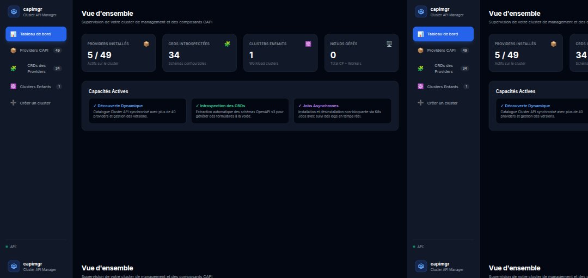
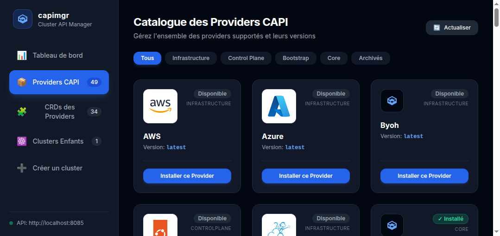
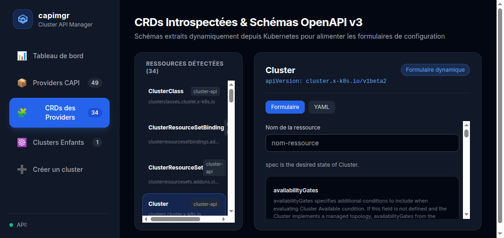
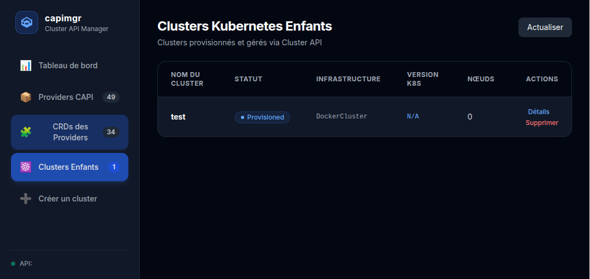
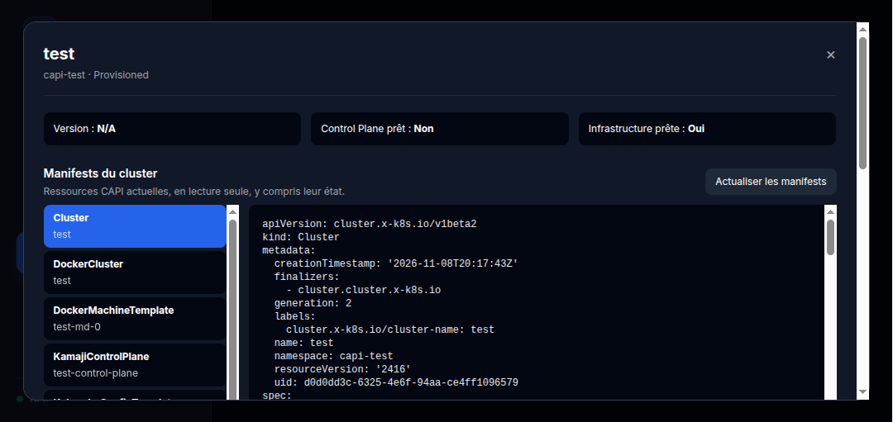
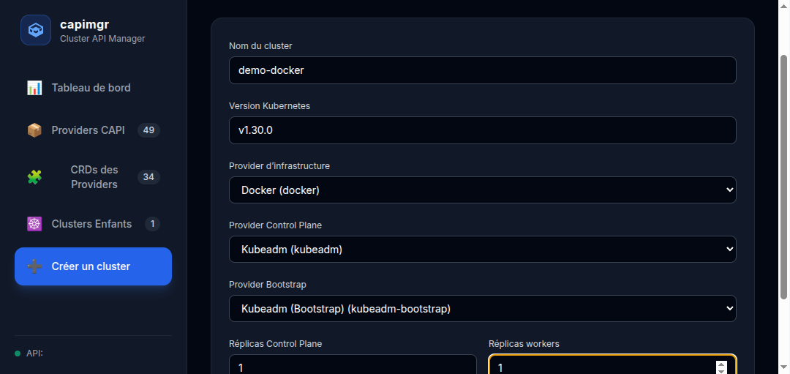
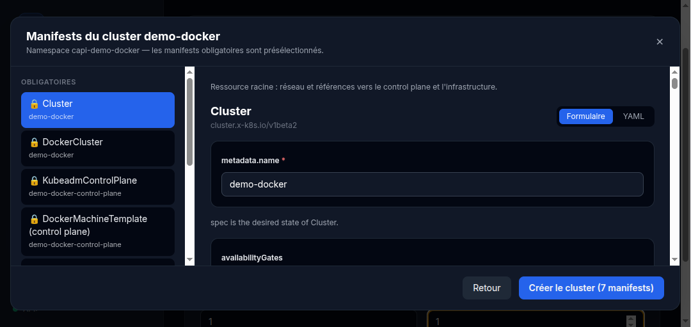

# capimgr

capimgr is a React interface and Go API for monitoring a Cluster API (CAPI) management cluster, its providers, CRDs, and workload clusters.

## Repository layout

- `backend/` — Go API, OpenAPI definition, and Swagger UI assets.
- `frontend/` — React application.
- `clusterctl/` — image used by provider installation jobs.
- `deploy/helm/` — recommended Helm deployment.
- `deploy/kubernetes/` — Kubernetes resources for deployments that do not use Helm.
- `deploy/legacy/` — older manifests retained for reference; they are not used by the current deployment.
- `docs/` — screenshots and project documentation.
- `openspec/` — feature specifications and change records.

The repository root is kept for the README, Makefile, and shared Git configuration.
The backend, frontend, and deployment chart remain in one repository because they
share an API contract and are currently built and deployed together. Separate
repositories may make sense if they later need independent release cycles,
maintainers, or consumers.

## Open-source project

capimgr is licensed under the [Apache License 2.0](./LICENSE). Contributions are
welcome; see [CONTRIBUTING.md](./CONTRIBUTING.md). Please follow the
[Code of Conduct](./CODE_OF_CONDUCT.md). To report a security issue privately,
see [SECURITY.md](./SECURITY.md).

Third-party packages, logos, and other bundled assets remain subject to their
own licenses and trademark terms. See the relevant package and asset notices;
the capimgr license does not relicense third-party material.

## Interface overview

These screenshots show a demonstration environment; versions, counts, and statuses depend on the management cluster. They show the French interface.

### Dashboard

The dashboard summarizes installed providers, discovered CRDs, and workload clusters.



### Provider catalog

Filter providers by category, inspect their status, and start installation or removal.
Known logos are bundled locally from [Simple Icons](https://simpleicons.org/) (CC0) and [Devicon](https://devicon.dev/) (MIT); trademarks remain the property of their owners. A generic blue icon is displayed when no logo is associated with a provider.



### CRD explorer

Select a CRD to browse its schema and use the generated form or its YAML representation.



### Workload clusters

The list displays cluster status and allows you to refresh it, open details, or request deletion.



In the details view, related manifests can be inspected and refreshed in read-only mode.



### Creating a cluster

Choose a name, Kubernetes version, installed providers, and replica counts.



After validation, browse required resources, add optional resources, and enter configuration in a form or YAML before creating the cluster.



## Prerequisites

- Go 1.21.7 or later
- Node.js 20+ and npm
- `kubectl` configured for a Kubernetes management cluster
- Cluster API installed on that cluster
- `clusterctl` installed locally and available in `PATH`
- The selected infrastructure, control plane, and bootstrap providers installed (their CRDs generate cluster manifests; no `ClusterClass` is required)

The backend uses the current `kubectl` context (or `KUBECONFIG`). For a deployment without Helm, the backend's Kubernetes account must have the permissions in [`deploy/kubernetes/rbac.yaml`](./deploy/kubernetes/rbac.yaml). Installation and removal jobs use the `clusterctl-installer-sa` service account.

## Local setup

1. Check the Kubernetes context:

   ```sh
   kubectl config current-context
   kubectl get crd clusters.cluster.x-k8s.io
   ```

2. Create the namespace and accounts/RBAC used by the jobs:

   ```sh
   kubectl apply -f deploy/kubernetes/rbac.yaml
   ```

   When running the backend directly on the host, the kubeconfig account also needs permission to read clusters, machines, MachineDeployments, CRDs, kubeconfig secrets, jobs, and pods. For development, a local management-cluster administrator context is simplest.

3. Check the local `clusterctl` configuration:

   ```sh
   clusterctl config repositories
   ```

   The backend uses this command to discover providers and default versions. Official providers are known to `clusterctl`; versions and statuses are discovered using the GitHub API and cached for 30 minutes. The unauthenticated API is limited to 60 requests per hour, so `GITHUB_TOKEN` is recommended (`make deploy GITHUB_TOKEN=...`). The Helm chart's ConfigMap is disabled by default and is only needed for custom providers. [`deploy/legacy/clusterctl-configmap.yaml`](./deploy/legacy/clusterctl-configmap.yaml) is a legacy example; review and update its provider versions before using it.

   [`deploy/legacy/manifests.yaml`](./deploy/legacy/manifests.yaml) is an older standalone deployment and is not maintained alongside the Helm chart. Use the Helm deployment below for a current installation.

## Running locally

Start the API in a terminal:

```sh
cd backend
go run .
```

The backend listens on `http://localhost:8080` by default. Change the port with `PORT`:

```sh
PORT=8081 go run .
```

In another terminal, install dependencies and start Vite:

```sh
cd frontend
npm ci
VITE_API_URL=http://localhost:8080 npm run dev -- --host 127.0.0.1
```

Open `http://127.0.0.1:5173`. The language selector in the sidebar switches between English and French. The initial language follows the first supported browser preference, falling back to English; an explicit choice is saved locally.

The sidebar's **API documentation (Swagger)** link opens the interactive Swagger UI in a new tab. It is also available directly at `http://localhost:8080/api/docs/` when running the backend locally, and the OpenAPI definition is at `/api/openapi.yaml`. The API documentation currently contains French descriptions. Swagger's "Try it out" sends real requests to the configured backend, including requests that modify cluster resources.

## Quick API check

From another terminal:

```sh
curl -i http://localhost:8080/api/clusters
curl -i http://localhost:8080/api/providers
curl -i http://localhost:8080/api/crds
curl -i 'http://localhost:8080/api/crds?group=infrastructure.cluster.x-k8s.io'
```

Inspect a CRD as follows (replace the name with an installed CRD):

```sh
curl -i http://localhost:8080/api/crds/awsclusters.infrastructure.cluster.x-k8s.io/schema
```

After obtaining an `id` from the cluster list:

```sh
CLUSTER_ID='<cluster-uid>'
curl -i "http://localhost:8080/api/clusters/${CLUSTER_ID}"
curl -i "http://localhost:8080/api/clusters/${CLUSTER_ID}/machines"
curl -i "http://localhost:8080/api/clusters/${CLUSTER_ID}/manifests"
curl -i -X PATCH "http://localhost:8080/api/clusters/${CLUSTER_ID}/scale" \
  -H 'Content-Type: application/json' \
  -d '{"workerReplicas": 5}'
curl -i "http://localhost:8080/api/clusters/${CLUSTER_ID}/kubeconfig"
```

The interface also supports creating, scaling, and deleting clusters, viewing conditions and machines, and copying or downloading kubeconfig. Installing or removing a provider creates an asynchronous Kubernetes job; its status and logs are available at `/api/jobs/{job-name}/status` and `/api/jobs/{job-name}/logs`.

In the workload cluster list, Refresh reloads the data. The details view offers read-only YAML for current CAPI resources in the namespace associated with the cluster by labels, owner, `spec.clusterName`, or explicit references. These are current objects, including status, not an archive of submitted manifests. Resources without a detectable link, secrets, and resources outside CAPI groups are excluded; a list of inaccessible types indicates an incomplete result. Some manifests may contain sensitive data.

> A kubeconfig grants access to the workload cluster: do not share it or store it in the repository. Removing a provider with `?includeCRD=true` can delete its custom resources; use this only in test environments after checking the consequences.

## Tests and build

```sh
cd backend
go test ./...
```

```sh
cd frontend
npm run build
```

Go tests validate backend helpers. Calls that modify Kubernetes (provider installation, cluster creation or deletion, and scaling) require a local test management cluster and appropriate Kubernetes permissions.

## Deploying to kind with Helm

Push images to the `192.168.1.9:5000` HTTP registry, then deploy the Helm chart in [`deploy/helm/capimgr`](./deploy/helm/capimgr):

```sh
make all                       # build, push, and deploy to kind cluster "kind"
make all KIND_CLUSTER=other TAG=v1 REGISTRY=192.168.1.9:5000
make port-forward              # UI at http://localhost:8080
make undeploy
```

- Docker must allow the insecure registry: `{"insecure-registries": ["192.168.1.9:5000"]}` in `/etc/docker/daemon.json`.
- `make kind-registry` configures containerd on kind nodes to pull from this registry (called by `make deploy`).
- The backend creates jobs in `capi-dashboard-system`; do not change this namespace. Clusterctl jobs use the dedicated `capimgr-clusterctl` image ([`clusterctl/clusterctl.Dockerfile`](./clusterctl/clusterctl.Dockerfile), `make push-clusterctl`, version set through `CLUSTERCTL_VERSION`); override it with `clusterctlImage` / `CLUSTERCTL_IMAGE`.
- The frontend proxies `/api` to the backend (nginx, `BACKEND_URL` variable). Enable optional ingress with `--set ingress.enabled=true`.
- Provider versions are listed dynamically (`GET /api/providers/{id}/versions`); providers whose repository is archived or deleted are disabled and categorized as archived.
- Cluster API must be installed on the kind cluster (`clusterctl init`) for `/api/clusters` to respond without errors.
