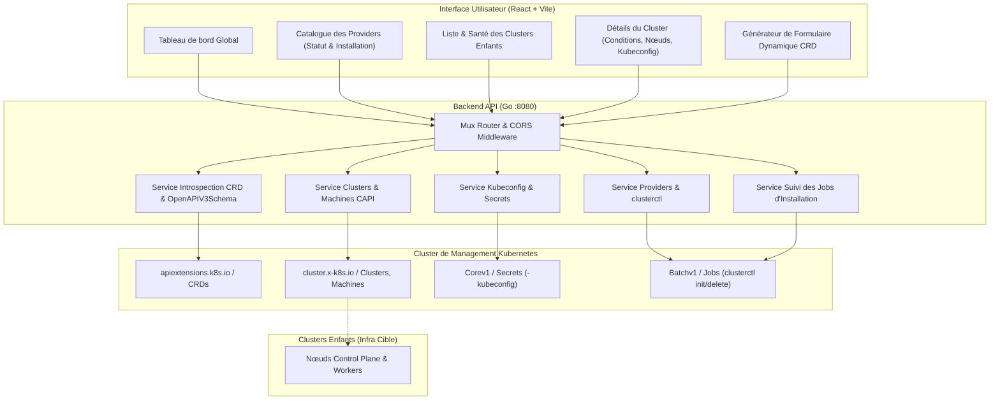
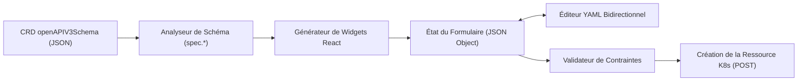

# Document de Conception Technique (Design) : capimgr

## 1. Vue d'Ensemble de l'Architecture

`capimgr` est structuré en deux blocs principaux :
1. **Backend Go** : Serveur HTTP léger communiquant avec le serveur d'API Kubernetes via `client.Client` (`sigs.k8s.io/controller-runtime`) et orchestrant `clusterctl` via des `batch/v1` Jobs K8s.
2. **Frontend React** : Application monopage (SPA) exploitant Vite, Tailwind CSS et un moteur de formulaire dynamique basé sur les schémas JSON extraits des CRDs.

---

## 2. Conception du Backend (Go)

### 2.1 Moteur d'Introspection des CRDs (`CRDSvc`)
Pour permettre la génération dynamique de formulaires :
- Le backend interroge `k8sClient.List(ctx, &apiextensionsv1.CustomResourceDefinitionList{})`.
- Pour une CRD donnée (ex: `awsclusters.infrastructure.cluster.x-k8s.io` ou `taloscontrolplanes.controlplane.cluster.x-k8s.io`), il localise la version active (`storage: true` ou version demandée).
- Il extrait le schéma `spec.versions[].schema.openAPIV3Schema`.
- Il effectue une transformation/nettoyage :
  - Extraction prioritaire de la sous-arborescence `properties.spec`.
  - Exclusion des champs en lecture seule (`status`, annotations internes de contrôleur).
  - Préservation des métadonnées riches : `description`, `type`, `enum`, `default`, `required`, `minimum`, `maximum`, `pattern`.
- L'endpoint `/api/crds/{name}/schema` renvoie ce JSON Schema prêt pour le frontend.

### 2.2 Gestion Dynamique des Providers (`ProviderSvc`)
- Au lieu de figer la liste des providers dans le code :
  - Lecture combinée de `clusterctl config repositories` et d'une ConfigMap K8s optionnelle (`capi-dashboard-system/clusterctl-config`).
  - Découverte automatique des versions disponibles et des URLs de release.
  - Détection dynamique de l'installation : vérification de l'existence des CRDs rattachées au groupe d'API du provider (ex: `infrastructure.cluster.x-k8s.io` pour un provider d'infra).
- Orchestration de `clusterctl init` et `clusterctl delete` via des Jobs K8s pour isoler l'exécution et éviter tout blocage du serveur HTTP.
- Suivi du cycle de vie des Jobs : `/api/jobs/{name}` pour renvoyer le statut (Pending, Running, Succeeded, Failed) et les logs d'exécution en temps réel.

### 2.3 Gestion Complète des Clusters Enfants (`ClusterSvc`)
- **Modèle enrichi** :
  - UID, Nom, Namespace, Version Kubernetes, Phase.
  - Conditions CAPI détaillées (`Ready`, `ControlPlaneReady`, `InfrastructureReady`).
  - Répartition des nœuds : nombre de Control Plane réels/désirés, nombre de Workers réels/désirés.
  - Références vers les ressources d'infrastructure (`spec.infrastructureRef`) et de control plane (`spec.controlPlaneRef`).
- **Création de cluster** :
  - Support de deux modes :
    1. **Mode ClusterClass** : si un `ClusterClass` existe, génération de l'objet `Cluster` avec variables configurées.
    2. **Mode Ressource unitaire / Template** : création combinée de l'objet `Cluster`, de la ressource d'infrastructure (ex: `AWSCluster`) et du control plane (ex: `KubeadmControlPlane`).
- **Opérations sur les clusters enfants** :
  - **Scale** : mise à jour des `spec.replicas` des `MachineDeployment` ou `KubeadmControlPlane`.
  - **Upgrade** : mise à jour de `spec.topology.version` ou `spec.version` du control plane.
  - **Kubeconfig** : extraction du secret K8s `<cluster-name>-kubeconfig` dans le namespace du cluster, encodé en base64 / texte brut pour téléchargement direct par l'utilisateur.

---

## 3. Conception du Frontend (React)

### 3.1 Moteur de Formulaire Dynamique de CRD
Le composant `CRDFormRenderer` reçoit le schéma JSON de la CRD et génère dynamiquement les champs :
- **Types simples** :
  - `string` -> `<input type="text">` (ou `<textarea>` si description longue).
  - `integer` / `number` -> `<input type="number">` avec validation min/max.
  - `boolean` -> Commutateur à bascule (Toggle switch) ou checkbox.
  - `enum` -> Menu déroulant `<select>`.
- **Types complexes** :
  - `object` -> Carte/Section pliable (Collapsible card) avec titre et description contextuelle.
  - `array of strings` -> Champ de tags/puces dynamiques (ajout/suppression d'éléments).
  - `array of objects` -> Liste dynamique avec bouton "Ajouter un élément".
  - `map[string]string` (labels, annotations) -> Paires clé-valeur éditables.
- **Fonctionnalités avancées** :
  - **Bascule Formulaire <-> YAML** : synchronisation bidirectionnelle temps réel. L'utilisateur peut pré-remplir le formulaire ou coller directement un fragment YAML.
  - **Validation à la volée** : affichage immédiat des erreurs si un champ obligatoire (`required`) est omis ou si un format est invalide.

### 3.2 Visualisation et Gestion des Clusters Enfants
- **Vue d'ensemble** :
  - Cartes d'indicateurs : état de santé, distribution par version K8s, distribution par provider.
  - Table avec filtres (par statut, provider, namespace).
- **Page détaillée de cluster** :
  - **Onglet Santé & Conditions** : timeline et badges colorés pour chaque condition CAPI.
  - **Onglet Nœuds & Machines** : liste détaillée des instances (nom, IP, phase, type d'instance, date de création).
  - **Onglet Kubeconfig** : bouton de copie dans le presse-papier, téléchargement du fichier `.kubeconfig`, et instructions de connexion avec `kubectl`.
  - **Onglet Actions** : redimensionnement du cluster (slider ou champ numérique pour les répliques), montée de version guidée, suppression avec confirmation de sécurité.

---

## 4. Spécification des Contrats d'API (REST)

| Méthode | Endpoint | Description |
|---|---|---|
| `GET` | `/api/providers` | Liste exhaustive des providers (statiques, clusterctl, installés via CRD) |
| `POST` | `/api/providers/{id}/install` | Lance le Job d'installation avec version optionnelle |
| `DELETE` | `/api/providers/{id}` | Lance le Job de désinstallation (option `includeCRD=true`) |
| `GET` | `/api/jobs/{id}/status` | Statut du Job K8s (Pending, Running, Succeeded, Failed) |
| `GET` | `/api/jobs/{id}/logs` | Logs d'exécution du Job (suivi en temps réel) |
| `GET` | `/api/crds` | Liste des CRDs présentes dans le cluster, filtrables par provider |
| `GET` | `/api/crds/{name}/schema` | Schéma OpenAPI v3 / JSON Schema nettoyé pour le formulaire |
| `GET` | `/api/clusters` | Liste de tous les clusters CAPI avec résumé des nœuds et état |
| `POST` | `/api/clusters` | Création d'un nouveau cluster enfant |
| `GET` | `/api/clusters/{id}` | Détails complets d'un cluster, conditions et références |
| `DELETE` | `/api/clusters/{id}` | Suppression sécurisée du cluster |
| `GET` | `/api/clusters/{id}/kubeconfig` | Récupération du kubeconfig du cluster enfant |
| `GET` | `/api/clusters/{id}/machines` | Liste des machines et MachineDeployments du cluster |
| `PATCH` | `/api/clusters/{id}/scale` | Mise à l'échelle des répliques workers ou control plane |

---

## 5. Sécurité et Modèle RBAC

- Le **Backend `capimgr`** opère avec un `ClusterRole` restreint :
  - Lecture/Écriture sur `cluster.x-k8s.io` (`clusters`, `machinedeployments`, `machines`, `clusterclasses`).
  - Lecture sur `apiextensions.k8s.io` (`customresourcedefinitions`).
  - Lecture sur `core/secrets` (uniquement les secrets suffixés par `-kubeconfig`).
  - Création et lecture sur `batch/jobs` dans le namespace `capi-dashboard-system`.
- Les **Jobs `clusterctl`** utilisent un ServiceAccount dédié (`clusterctl-installer-sa`) doté des autorisations nécessaires pour enregistrer les webhooks et CRDs du provider.
